# Building blocks

Every RAG type is made of the same small parts. Each part has a **base class**
that says what methods it needs, and one or more ready-made classes.

```
Indexing:   Loader -> Chunker -> Embedder -> VectorStore
Answering:  Retriever -> Reranker -> Generator  (each uses the LLM / Embedder)
```




| Part      | Base class      | Ready-made classes                                | Folder                 |
|-----------|-----------------|---------------------------------------------------|------------------------|
| LLM       | `BaseLLM`       | `OllamaLLM`                                       | `llm/`                 |
| Loader    | `BaseLoader`    | `PdfLoader`, `DocxLoader`                         | `loaders/`             |
| Chunker   | `BaseChunker`   | `WordChunker`, `CharacterChunker`, `TokenChunker` | `chunking/`            |
| Embedder  | `BaseEmbedder`  | `OllamaEmbedder`                                  | `embeddings/`          |
| Store     | `BaseStore`     | `MemoryStore`                                     | `vector_stores/`       |
| Retriever | –               | `Retriever`                                       | `retrieval/`           |
| Reranker  | `BaseReranker`  | `KeywordReranker`, `NoReranker`                   | `retrieval/rerankers/` |
| Generator | `BaseGenerator` | `GroundedGenerator`                               | `generation/`          |

## The data passed between parts

Everything is a plain Python `dict`, so it is easy to print and inspect.

**Document** (made by a loader)

```python
{"source": "handbook.pdf", "file_type": ".pdf", "text": "all the text..."}
```

**Chunk** (made by a chunker)

```python
{"id": "chunk_0", "source": "handbook.pdf", "text": "150 words..."}
```

**Match** (made by the retriever, then the reranker)

```python
{"id": "chunk_0", "source": "handbook.pdf", "text": "...",
 "score": 0.82, "rerank_score": 0.97}
```

## Fixed-length chunkers

Each one cuts text into windows of the same size. With an overlap, each new
chunk repeats the end of the previous one, so a sentence on a boundary is not
lost. Example: size 4, overlap 1 on `"abcdefghij"` gives `"abcd"`, `"defg"`, `"ghij"`.

| Chunker            | Counts                 | Pick it with        | Good for                                |
|--------------------|------------------------|---------------------|-----------------------------------------|
| `WordChunker`      | words                  | `CHUNKER=word`      | the default, easy to reason about       |
| `CharacterChunker` | characters             | `CHUNKER=character` | any language, exact text kept           |
| `TokenChunker`     | tokens                 | `CHUNKER=token`     | staying under the embedding model limit |
| `RecursiveChunker` | characters (or tokens) | `CHUNKER=recursive` | keeping paragraphs and sentences whole  |

```python
from rag_titan.chunking import CharacterChunker, RecursiveChunker, TokenChunker, WordChunker

WordChunker(chunk_size=150, overlap=30).split_text(text)
CharacterChunker(chunk_size=1000, overlap=200).split_text(text)
TokenChunker(chunk_size=256, overlap=32).split_text(text)   # uses tiktoken
RecursiveChunker(chunk_size=1000, overlap=200).split_text(text)
```

An overlap of the chunk size or more raises `ValueError`, and blank text gives
no chunks.

### Recursive separators

`RecursiveChunker` never cuts in the middle of a sentence when it does not have to.
It splits on the biggest separator first and only uses a smaller one for a
piece that is still too big:

1. paragraphs (`"\n\n"`), then lines (`"\n"`), sentences (`". "`), words (`" "`)
2. a hard cut, only for a single piece longer than `chunk_size`
3. small pieces are packed together until the next one would not fit

Overlap repeats whole pieces (for example the last sentence), so it is *up to*
`overlap` and never cuts a sentence to reach it. Pass `separators=` to change
the order, or `tokenizer=` to count tokens instead of characters.

### Overlap costs space

Overlap repeats text, so the index grows. Check the cost before indexing with
`count_windows(n, size, overlap)`:

```python
from rag_titan.chunking import count_windows

count_windows(1000, 100, 0)    # 10 chunks
count_windows(1000, 100, 20)   # 13 chunks: 30% more to embed and store
```

The handbook suggests trying overlap 0 and 10-15% of the chunk size, then
keeping whichever retrieves better on your own questions.

### Tokens: tiktoken or your own tokenizer

`TokenChunker` uses [tiktoken](https://github.com/openai/tiktoken) by default.
It is an optional extra, so install it first:

```bash
pip install "rag-titan[tokens]"
```

Pick the encoding with `encoding="cl100k_base"` (or `CHUNK_ENCODING` in `.env`).

To count tokens exactly like your embedding model, pass your own tokenizer:
any object with `encode(text)` returning ids and `decode(ids)` returning text.
For a Hugging Face tokenizer, wrap it so no special tokens are added:

```python
from transformers import AutoTokenizer

from rag_titan.chunking import TokenChunker


class HFTokenizer:
    def __init__(self, name):
        self.tokenizer = AutoTokenizer.from_pretrained(name)

    def encode(self, text):
        return self.tokenizer.encode(text, add_special_tokens=False)

    def decode(self, ids):
        return self.tokenizer.decode(ids)


chunker = TokenChunker(chunk_size=256, overlap=32, tokenizer=HFTokenizer("BAAI/bge-small-en-v1.5"))
```

All of them are built on one helper, `fixed_windows(units, size, overlap)`,
which works on any string or list if you want to write your own.

## Building a RAG by hand

```python
from rag_titan import SimpleRAG
from rag_titan.chunking import WordChunker
from rag_titan.embeddings import OllamaEmbedder
from rag_titan.generation import GroundedGenerator
from rag_titan.llm import OllamaLLM
from rag_titan.pipelines import IndexingPipeline
from rag_titan.retrieval import Retriever
from rag_titan.retrieval.rerankers import KeywordReranker
from rag_titan.vector_stores import MemoryStore

llm = OllamaLLM("gemma3:4b")
embedder = OllamaEmbedder("nomic-embed-text")
store = MemoryStore()

IndexingPipeline(WordChunker(200, 40), embedder, store).run(["handbook.pdf"])

rag = SimpleRAG(Retriever(embedder, store), KeywordReranker(), GroundedGenerator(llm))
print(rag.answer("How many leave days do I get?"))
```

## Prompts

All RAG prompts live in `rag_titan/prompts.py` so they are easy to read and tune.
To use your own answer prompt:

```python
GroundedGenerator(llm, instructions="Answer in one short sentence. Cite chunk ids.")
```
