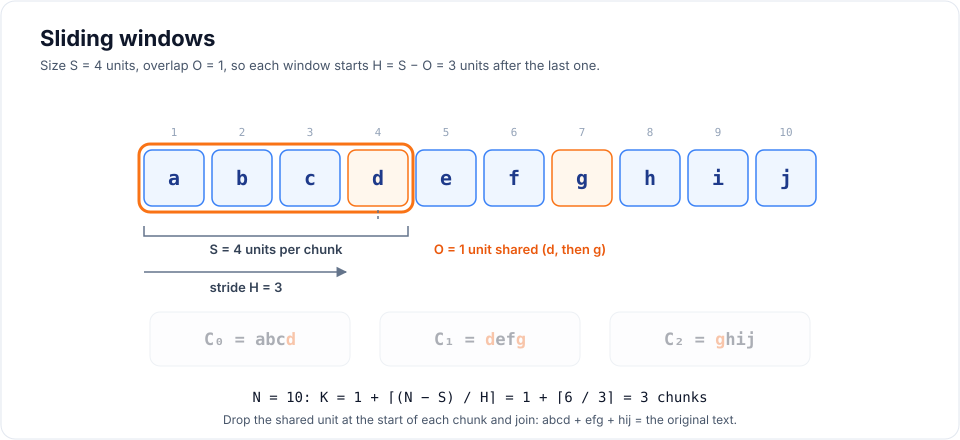

# Chunking methods

A RAG system never searches whole files. It searches **chunks**: small pieces of
text that are embedded and stored one by one. How you cut the text decides what
the retriever can find, so chunking is one of the settings that matters most.

- Chunks that are **too big** mix several topics. Their vectors get blurry and the
  LLM receives a lot of text it does not need.
- Chunks that are **too small** lose context. "It is 20 days" means nothing
  without the sentence before it.

rag-titan ships ten chunkers in three families from the chunking handbook:
**fixed-size** (section 2) cuts by counting units, **structure-aware**
(section 3) keeps the document's own units whole, and **statistical** (section 5)
cuts where the words of the text change. More families are on the
[roadmap](roadmap.md).

| Chunker            | Family          | Counts                 | Setting             | Keeps whole                                |
|--------------------|-----------------|------------------------|---------------------|--------------------------------------------|
| `WordChunker`      | fixed-size      | words                  | `CHUNKER=word`      | words                                      |
| `CharacterChunker` | fixed-size      | characters             | `CHUNKER=character` | nothing (exact text)                       |
| `TokenChunker`     | fixed-size      | model tokens           | `CHUNKER=token`     | tokens                                     |
| `RecursiveChunker` | fixed-size      | characters (or tokens) | `CHUNKER=recursive` | paragraphs, lines, sentences when they fit |
| `SentenceChunker`  | structure-aware | characters (or tokens) | `CHUNKER=sentence`  | sentences                                  |
| `ParagraphChunker` | structure-aware | characters (or tokens) | `CHUNKER=paragraph` | paragraphs                                 |
| `HeadingChunker`   | structure-aware | characters (or tokens) | `CHUNKER=heading`   | sections (never mixes two)                 |
| `PageChunker`      | structure-aware | characters (or tokens) | `CHUNKER=page`      | pages (never spans two)                    |
| `MarkdownChunker`  | structure-aware | characters             | `CHUNKER=markdown`  | lists, tables, code, quotes; sections      |
| `TextTilingChunker` | statistical    | characters (or tokens) | `CHUNKER=texttiling` | sentences; never mixes two topics it found |

!!! tip "Try it: chunk playground"
    Paste your own text and watch every chunker on this page cut it, live in
    your browser: **[open the chunk playground](playground.md)**.

## What every chunker returns

Every chunker inherits from `BaseChunker`, so they all work the same way:
`split_text(text)` returns a list of strings, and `chunk(documents)` turns
document dicts into chunk dicts: an id, the source file, the text, and **where
the chunk is** in the document.

```python
from rag_titan.chunking import WordChunker

WordChunker(chunk_size=4, overlap=0).chunk(
    [{"source": "policy.pdf", "text": "Staff get twenty days of paid leave."}]
)
# [{'id': 'chunk_0', 'source': 'policy.pdf', 'text': 'Staff get twenty days',
#   'start_offset': 0, 'end_offset': 21},
#  {'id': 'chunk_1', 'source': 'policy.pdf', 'text': 'of paid leave.',
#   'start_offset': 22, 'end_offset': 36}]
```

| Field          | When                         | Meaning                                                                    |
|----------------|------------------------------|----------------------------------------------------------------------------|
| `id`           | always                       | `chunk_0`, `chunk_1`, ... in order                                         |
| `source`       | always                       | the file name                                                              |
| `text`         | always                       | the text that is embedded and shown to the LLM                             |
| `start_offset` | always                       | where the chunk starts in the document text                                |
| `end_offset`   | always                       | where it ends: `document["text"][start:end]` is the chunk                  |
| `page_numbers` | PDFs (text with page breaks) | the pages the chunk covers, for example `[3]` or `[3, 4]`                  |
| `section_path` | documents with headings      | the headings above the chunk, for example `["Leave policy", "Sick leave"]` |

### Offsets, pages and sections

The offsets point at the chunk's own text in the document, so an answer can be
traced back to the exact place in the file:

```python
from rag_titan.chunking import HeadingChunker, PageChunker

text = "# Leave policy\n\nStaff get twenty days.\f## Sick leave\n\nTell your manager."
chunks = PageChunker(chunk_size=60).chunk([{"source": "handbook.pdf", "text": text}])

chunks[1]
# {'id': 'chunk_1', 'source': 'handbook.pdf', 'text': '## Sick leave\n\nTell your manager.',
#  'start_offset': 39, 'end_offset': 72,
#  'page_numbers': [2], 'section_path': ['Leave policy', 'Sick leave']}

text[chunks[1]["start_offset"]:chunks[1]["end_offset"]]
# '## Sick leave\n\nTell your manager.'

HeadingChunker(chunk_size=100).chunk(
    [{"source": "handbook.md", "text": "# Leave policy\n\n## Sick leave\n\nTell your manager."}]
)
# [{'id': 'chunk_0', 'source': 'handbook.md',
#   'text': 'Leave policy > Sick leave\n\nTell your manager.',
#   'start_offset': 31, 'end_offset': 49, 'section_path': ['Leave policy', 'Sick leave']}]
```

- **Exact, not searched.** Every chunker except `TokenChunker` knows where each
  chunk is while it cuts, so the offsets are exact, even in very repetitive
  text. `TokenChunker` and chunkers you write yourself get offsets by searching
  for each chunk in order; a chunk that cannot be found gets `None`.
- **`WordChunker`** joins words with single spaces, so its `text` can differ
  from the source in spacing; the offsets cover the original spacing.
- **`HeadingChunker`** puts the heading path in front of the text; the offsets
  point at the section text itself, without the path.
- **Pages** come from the page breaks the PDF loader keeps (`\f`); empty pages
  still count, so the numbers match the PDF.
- **Section path** is the heading open where the chunk starts, with any chunker
  (not only `HeadingChunker`); `[]` means before the first heading.

### Citations in answers

The answer context shows where each chunk comes from, and the prompt lets the
LLM cite the page, such as `[chunk_1, page 2]`:

```text
[chunk_0] Source: handbook.pdf, page 1, section: Leave policy
# Leave policy

Staff get twenty days.

[chunk_1] Source: handbook.pdf, page 2, section: Leave policy > Sick leave
## Sick leave

Tell your manager.
```

## Sliding windows: the maths behind fixed-size chunking

`WordChunker`, `CharacterChunker` and `TokenChunker` all do the same thing on a
different kind of *unit* (a word, a character or a token). They share one helper,
`fixed_windows()`, and one set of formulas.

### The window

Write the text as a list of $N$ units $D = (u_1, u_2, \dots, u_N)$ and pick:

- the **size** $S$: units per chunk (`chunk_size`)
- the **overlap** $O$: units shared by two neighbouring chunks, with $0 \le O < S$

Each new window starts $H$ units after the previous one. $H$ is the **stride**:

$$
H = S - O
$$

Window number $i$ (counting from 0) holds the units from position $iH$ up to,
but not including, $iH + S$:

$$
C_i = \big(u_{iH+1},\ \dots,\ u_{\min(iH+S,\ N)}\big)
$$

The last window may be shorter than $S$. All the others have exactly $S$ units.

```python
from rag_titan.chunking import fixed_windows

fixed_windows([1, 2, 3, 4, 5, 6, 7], size=3, overlap=1)
# [[1, 2, 3], [3, 4, 5], [5, 6, 7]]     S = 3, O = 1, H = 2

fixed_windows("abcdefghij", size=4, overlap=1)
# ['abcd', 'defg', 'ghij']              S = 4, O = 1, H = 3
```



!!! warning "Why overlap must be smaller than size"
    With $O \ge S$ the stride $H$ is zero or negative, so the window would never
    move forward. Every chunker raises `ValueError` for that, and for $S \le 0$
    or $O < 0$.

### How many chunks?

The number of windows $K$ for a text of $N$ units is:

$$
K =
\begin{cases}
0 & \text{if } N = 0 \\
1 & \text{if } 0 < N \le S \\
1 + \left\lceil \dfrac{N - S}{H} \right\rceil & \text{if } N > S
\end{cases}
$$

`count_windows(n, size, overlap)` computes $K$ without making the chunks, and
the tests check it against `len(fixed_windows(...))` for every length up to 40.

### What overlap costs

Overlap stores some text twice. Compared with no overlap, the index grows by
about the **amplification factor**:

$$
A \approx \frac{S}{H} = \frac{S}{S - O} = \frac{1}{1 - o}
\qquad \text{where } o = \frac{O}{S}
$$

So 10% overlap costs about 11% more vectors, 20% costs 25% and 40% costs 67%.
Check it for your own data before indexing:

```python
from rag_titan.chunking import count_windows

# a 10,000-word handbook in 500-word chunks
count_windows(10_000, 500, 0)     # 20 chunks
count_windows(10_000, 500, 50)    # 23 chunks  (10% overlap)
count_windows(10_000, 500, 100)   # 25 chunks  (20% overlap, A = 1.25)
count_windows(10_000, 500, 200)   # 33 chunks  (40% overlap)
```

Overlap helps when an answer sits on a boundary between two chunks. It also
means neighbouring chunks are similar, so a search can return two chunks with
mostly the same text. More overlap is not automatically better.

### Removing near-copies from search results

The retriever removes those near-copies for you (handbook 2.4). It asks the
vector store for twice as many results, walks them best first, and drops a
result that overlaps a better one **from the same file** by at least half of
the shorter chunk, using the chunk offsets:

$$
\text{overlap}(a, b) = \frac{\text{shared characters}}{\min(|a|, |b|)}
$$

```python
from rag_titan.retrieval import overlap_fraction, remove_duplicates

hits = [
    {"id": "chunk_3", "source": "hr.pdf", "start_offset": 0, "end_offset": 100},
    {"id": "chunk_4", "source": "hr.pdf", "start_offset": 50, "end_offset": 150},
    {"id": "chunk_9", "source": "hr.pdf", "start_offset": 400, "end_offset": 500},
]
overlap_fraction(hits[0], hits[1])          # 0.5
[hit["id"] for hit in remove_duplicates(hits)]
# ['chunk_3', 'chunk_9']
```

So the answer context gets more *different* evidence instead of the same
passage twice. Set `DEDUPE_OVERLAP` to a share between 0 and 1 (default `0.5`),
or to `off` to keep every result. Chunks without offsets (from your own
chunkers, when they cannot be found) only count as copies when their text is
exactly the same.

### Guarantees

Every fixed-size chunker is tested for these rules (from the handbook's
acceptance tests):

- **Nothing is lost.** Dropping the first $O$ units of every chunk except the
  first and joining the rest gives back the original units:
  $D = C_0 \,\Vert\, C_1[O{:}] \,\Vert\, C_2[O{:}] \,\Vert\, \cdots$
- **No empty chunks.** Empty or blank text gives `[]`.
- **Exact sizes.** Every chunk has $S$ units except the last one.
- **Fast.** One pass over the text: time grows linearly with the text,
  $\mathcal{O}(N)$, plus $\mathcal{O}(K \cdot S)$ to copy the chunks out.

### One sentence, three units

The only difference between the three fixed-size chunkers is what they count.
Here is the same sentence cut by each one (real output):



## WordChunker

Splits on whitespace and counts words. It is the default because word counts are
easy to reason about: "150 words" is roughly one paragraph.



*Watch each window of 6 words light up; the 2 shared words are filled orange.*

```python
from rag_titan.chunking import WordChunker

WordChunker(chunk_size=5, overlap=2).split_text(
    "Staff get twenty days of paid leave every year."
)
# ['Staff get twenty days of', 'days of paid leave every', 'leave every year.']
```

| | |
|---|---|
| **Unit** | a word (`text.split()`) |
| **Settings** | `CHUNKER=word`, `CHUNK_SIZE=150`, `CHUNK_OVERLAP=30` (the defaults) |
| **Good for** | a simple, predictable start on prose |
| **Watch out** | line breaks and double spaces become single spaces; word count is only roughly model tokens (about 1.3 tokens per English word) |

## CharacterChunker

Cuts the raw string every $S$ characters (handbook 2.1). The text is kept exactly
as it is, spaces and newlines included, so it works for any language, even ones
without spaces between words.



*Each box is one character. Note the cuts in the middle of words: `the fo` | `rm`.*

```python
from rag_titan.chunking import CharacterChunker

CharacterChunker(chunk_size=12, overlap=4).split_text("Leave policy: twenty days.")
# ['Leave policy', 'licy: twenty', 'enty days.']
```

| | |
|---|---|
| **Unit** | a character |
| **Settings** | `CHUNKER=character`, for example `CHUNK_SIZE=1000`, `CHUNK_OVERLAP=150` |
| **Good for** | exact, lossless chunks; languages without spaces; code or logs |
| **Watch out** | chunks start and end in the middle of words (`'licy: twenty'`) |

## TokenChunker

Counts **model tokens**, the units an embedding model reads (handbook 2.3). Every
embedding model has a maximum input length in tokens. Counting with the same
tokenizer is the only way to be sure no chunk is cut off by the model.



*Real tiktoken tokens: the blank line is one token, and each full stop is its own.*

The text is encoded to token ids, the ids are cut with `fixed_windows`, and each
window is decoded back to text:

```python
from rag_titan.chunking import TokenChunker

chunker = TokenChunker(chunk_size=6, overlap=2)     # tiktoken, "cl100k_base"
text = "Tokenizers split unbelievably long words into pieces."

[chunker.tokenizer.decode([i]) for i in chunker.tokenizer.encode(text)]
# ['Token', 'izers', ' split', ' unbelie', 'vably', ' long',
#  ' words', ' into', ' pieces', '.']                   10 tokens

chunker.split_text(text)
# ['Tokenizers split unbelievably long', 'vably long words into pieces.']
```

Notice that one word can be several tokens, and a chunk can start inside a word
(`'vably'`).

### tiktoken (default)

tiktoken is an optional extra, so install it first:

```bash
pip install "rag-titan[tokens]"
```

Pick the encoding with `encoding=` or `CHUNK_ENCODING` (default `cl100k_base`).
tiktoken downloads the encoding file the first time it is used, so the first run
needs internet.

### Your own tokenizer

Pass any object with `encode(text)` returning a list of ids and `decode(ids)`
returning text. Use this to count exactly like your embedding model, for example
a Hugging Face model:

```python
from transformers import AutoTokenizer

from rag_titan.chunking import TokenChunker


class HFTokenizer:
    def __init__(self, name):
        self.tokenizer = AutoTokenizer.from_pretrained(name)

    def encode(self, text):
        # no [CLS]/[SEP]: we only want to count the text itself
        return self.tokenizer.encode(text, add_special_tokens=False)

    def decode(self, ids):
        return self.tokenizer.decode(ids)


chunker = TokenChunker(chunk_size=256, overlap=32, tokenizer=HFTokenizer("BAAI/bge-small-en-v1.5"))
```

| | |
|---|---|
| **Unit** | a model token |
| **Settings** | `CHUNKER=token`, `CHUNK_ENCODING=cl100k_base`, for example `CHUNK_SIZE=256`, `CHUNK_OVERLAP=32` |
| **Good for** | staying under the embedding model's limit; comparable chunk sizes across languages |
| **Watch out** | needs tiktoken or your own tokenizer; decoding and encoding again can shift a count by a token at the edges with some tokenizers |

## RecursiveChunker

Fixed windows ignore the meaning of the text. `RecursiveChunker` (handbook 2.5)
keeps the same size limit but prefers to cut where the text already has a break.



*The extra sentence "Dr. Lee signs it within 3.5 days." shows the weak spot: recursive splits on any `". "`, so `Dr.` ends up at the end of the previous chunk. Compare with `SentenceChunker` below.*

### How it works

It has a list of separators, biggest first:

| Order | Separator | Breaks at  |
|-------|-----------|------------|
| 1     | `"\n\n"`  | paragraphs |
| 2     | `"\n"`    | lines      |
| 3     | `". "`    | sentences  |
| 4     | `" "`     | words      |
| 5     | `""`      | anywhere (hard cut, last resort) |

1. **Split.** If the text fits in $S$, keep it. Otherwise split on the first
   separator that appears in it, keeping the separator at the end of each piece
   so no text is lost. Any piece that is still too big is split again with the
   *next* separator.
2. **Merge.** Walk through the pieces and pack them into a chunk until the next
   piece would make it bigger than $S$.
3. **Overlap.** Start the next chunk with the last *whole* pieces of the previous
   one, as long as they add up to at most $O$.

```text
split(text, separators):
    if size(text) <= S:            return [text]
    sep = first separator found in text
    if sep == "":                  return hard_cut(text)          # fixed_windows
    pieces = []
    for part in text split on sep (sep kept):
        pieces += split(part, separators after sep)
    return pieces

merge(pieces):
    chunk = []
    for piece in pieces:
        if size(chunk + piece) > S:
            emit chunk
            chunk = last whole pieces of chunk with total size <= O
        chunk += piece
    emit chunk
```

In symbols: with piece sizes $\ell(p_j)$, each chunk is the longest run of
pieces $p_a, \dots, p_b$ with

$$
\sum_{j=a}^{b} \ell(p_j) \le S
$$

and the overlap is the longest run of whole pieces at its end with
$\sum \ell(p_j) \le O$.

### Example

```python
from rag_titan.chunking import RecursiveChunker

doc = (
    "Leave policy\n\n"
    "Staff get twenty days. Unused days carry over. "
    "Ask HR for the form. Sick leave is separate."
)

RecursiveChunker(chunk_size=50, overlap=0).split_text(doc)
# ['Leave policy\n\nStaff get twenty days.',
#  'Unused days carry over. Ask HR for the form.',
#  'Sick leave is separate.']

RecursiveChunker(chunk_size=50, overlap=25).split_text(doc)
# ['Leave policy\n\nStaff get twenty days.',
#  'Staff get twenty days. Unused days carry over.',
#  'Unused days carry over. Ask HR for the form.',
#  'Ask HR for the form. Sick leave is separate.']
```

The second paragraph is longer than 50 characters, so it falls back to
sentences. No sentence is ever cut, and with overlap each chunk repeats the
previous sentence.

!!! note "Overlap is *up to* `overlap`"
    Only whole pieces are repeated. A piece longer than $O$ is never repeated,
    so with long sentences and a small overlap you may see no overlap at all.
    That is on purpose: cutting a sentence in half to fill the overlap would
    defeat the point of this chunker.

### Options

```python
RecursiveChunker(
    chunk_size=1000,
    overlap=200,
    separators=("\n\n", "\n", ". ", " ", ""),   # biggest first; "" = hard cut
    tokenizer=None,                             # pass one to count tokens
)
```

For Markdown you could try `separators=("\n## ", "\n### ", "\n\n", "\n", ". ", " ", "")`
so headings start new chunks.

| | |
|---|---|
| **Unit** | characters, or tokens with `tokenizer=` |
| **Settings** | `CHUNKER=recursive`, for example `CHUNK_SIZE=1000`, `CHUNK_OVERLAP=200` |
| **Good for** | a strong general default for reports, docs and policies |
| **Watch out** | spaces at the edges of chunks are trimmed; with a tokenizer, piece token counts are added up, which can differ from encoding the whole chunk by about a token |

## Structure-aware chunkers

Fixed-size chunkers count units. Structure-aware chunkers (handbook section 3)
first cut the text into the units the author wrote: sentences, paragraphs,
sections or pages. Then they pack whole units into chunks of at most
`chunk_size`, with the same packing step as `RecursiveChunker`:

$$
C_j = (u_a, \dots, u_b) \qquad \text{with} \qquad \sum_{i=a}^{b} \ell(u_i) \le S
$$

A unit is only cut when it is bigger than $S$ on its own: a paragraph falls
back to sentences, and a sentence falls back to words. Overlap repeats whole
units, up to $O$. Sizes count characters, or tokens with `tokenizer=`.

### What the loaders keep

These chunkers need the document's structure, so the loaders keep it:

| File          | Paragraphs                | Headings                                  | Pages                          |
|---------------|---------------------------|-------------------------------------------|--------------------------------|
| `.docx`       | separated by a blank line | Word "Heading 1-6" become `#` to `######` | no pages in Word files         |
| `.pdf`        | lines as pypdf reads them | none                                      | separated by `\f` (page break) |
| `.md`, `.txt` | as written                | Markdown `#` headings                     | none                           |

### SentenceChunker

Packs whole sentences (handbook 3.1). The sentence splitter needs no library
and knows the common traps: abbreviations (`Dr.`, `Mr.`, `etc.`, `Fig.`),
dotted forms (`e.g.`, `U.S.`), initials (`J. K.`), list numbers (`1.`),
decimals (`3.5`), quotes, `...`, and the end marks `。！？।` used in Japanese,
Chinese and Hindi.



*Same text as the recursive diagram: here `Dr. Lee signs it within 3.5 days.` stays whole.*

```python
from rag_titan.chunking import SentenceChunker
from rag_titan.chunking.structure_aware import split_sentences

split_sentences("Dr. Smith said it takes 3.5 days. Ask HR, e.g. Ann. Done!")
# ['Dr. Smith said it takes 3.5 days. ', 'Ask HR, e.g. Ann. ', 'Done!']

doc = (
    "# Leave policy\n\n"
    "Staff get twenty days. Unused days carry over. Ask HR for the form.\n\n"
    "Sick leave is separate. Tell your manager before nine."
)
SentenceChunker(chunk_size=50, overlap=25).split_text(doc)
# ['# Leave policy\n\nStaff get twenty days.',
#  'Staff get twenty days. Unused days carry over.',
#  'Unused days carry over. Ask HR for the form.',
#  'Ask HR for the form.\n\nSick leave is separate.',
#  'Tell your manager before nine.']
```

!!! note "One trade-off"
    A single letter before a full stop is read as an initial, like `J. K.`
    So `"Plan B. Then we go."` stays one sentence. That is the safer mistake:
    gluing two sentences together loses nothing, while cutting a name in two
    would.

| | |
|---|---|
| **Settings** | `CHUNKER=sentence`, for example `CHUNK_SIZE=500`, `CHUNK_OVERLAP=100` (defaults) |
| **Good for** | FAQs, chat logs, short answers: retrieving the exact sentences |
| **Watch out** | a chunk can join the end of one paragraph with the start of the next |

### ParagraphChunker

Packs whole paragraphs, separated by a blank line (handbook 3.2). The handbook
calls paragraph grouping "frequently a strong general baseline for reports and
documentation".



*The same sentences written as paragraphs: the heading packs with the first paragraph.*

```python
from rag_titan.chunking import ParagraphChunker

ParagraphChunker(chunk_size=60, overlap=0).split_text(doc)
# ['# Leave policy\n\nStaff get twenty days.',
#  'Unused days carry over. Ask HR for the form.',
#  'Sick leave is separate. Tell your manager before nine.']
```

The middle paragraph has 69 characters, more than 60, so it falls back to
sentences. The last paragraph fits, so it stays whole.

| | |
|---|---|
| **Settings** | `CHUNKER=paragraph`, for example `CHUNK_SIZE=1000`, `CHUNK_OVERLAP=0` (defaults) |
| **Good for** | reports, policies, documentation, Word files |
| **Watch out** | PDFs give lines, not paragraphs, so on PDFs it packs lines |

### HeadingChunker

Splits at headings, so **a chunk never mixes two sections**, and starts each
chunk with its **heading path** (handbook 3.3). A heading closes every open
heading at its level or deeper, which builds the path:



*Each chunk stays inside its section and starts with its heading path.*

$$
C_i = (h_1, \dots, h_d,\ \text{body}_i)
$$

```python
from rag_titan.chunking import HeadingChunker

md = (
    "# Leave policy\n\n## Annual leave\n\nStaff get twenty days.\n\n"
    "## Sick leave\n\nTell your manager.\n\n# Travel\n\nBook trips early."
)
HeadingChunker(chunk_size=200).split_text(md)
# ['Leave policy > Annual leave\n\nStaff get twenty days.',
#  'Leave policy > Sick leave\n\nTell your manager.',
#  'Travel\n\nBook trips early.']

HeadingChunker(chunk_size=200, include_path=False).split_text(md)
# ['# Leave policy\n\n## Annual leave\n\nStaff get twenty days.',
#  '## Sick leave\n\nTell your manager.',
#  '# Travel\n\nBook trips early.']
```

- The path tells the retriever and the LLM *where* a chunk comes from: "20
  days" means little until you know it is under *Annual leave*.
- The path counts toward `chunk_size`. If it would take more than half of
  a chunk, it is left out.
- `#` lines inside code blocks (```` ``` ````) are code, not headings.
- Inside a section, paragraphs are packed like `ParagraphChunker`.

| | |
|---|---|
| **Settings** | `CHUNKER=heading`, for example `CHUNK_SIZE=1000`, `CHUNK_OVERLAP=0` (defaults) |
| **Good for** | Markdown docs, Word files with headings, handbooks, wikis |
| **Watch out** | text with no headings becomes one section; very short sections make very short chunks |

### MarkdownChunker

Element-aware chunking (handbook 3.5 and 3.7): it reads Markdown as **blocks**
(paragraphs, lists, tables, code blocks, quotes such as `> **Warning**`) and packs
whole blocks, section by section like `HeadingChunker`, with the heading path in
front. What `paragraph` and `heading` cut at blank lines stays together here:

- a code block, even with blank lines or `#` lines inside;
- a table row, and a list item with its wrapped lines;
- a lead-in line ending in `:` ("You get:", "Run once:") with the list, table or
  code block right after it.

```python
from rag_titan.chunking import HeadingChunker, MarkdownChunker

md = ("# Errors\n\nError codes:\n| Code | Meaning |\n|------|---------|\n"
      "| E-1 | VPN down |\n| E-2 | Password too old |\n| E-3 | Disk full |\n"
      "| E-4 | Printer offline |\n| E-5 | Badge blocked |\n\n"
      "## Setup\n\nRun once:\n\n```bash\n# not a heading\n\nsudo setup\n```\n")

MarkdownChunker(chunk_size=130).split_text(md)
# ['Errors\n\nError codes:\n| Code | Meaning |\n|------|---------|\n| E-1 | VPN down |\n| E-2 | Password too old |\n| E-3 | Disk full |',
#  'Errors\n\nError codes:\n| Code | Meaning |\n|------|---------|\n| E-4 | Printer offline |\n| E-5 | Badge blocked |',
#  'Errors > Setup\n\nRun once:\n\n```bash\n# not a heading\n\nsudo setup\n```']

HeadingChunker(chunk_size=130).split_text(md)[1]
# 'Errors\n\nE-4 | Printer offline |\n| E-5 | Badge blocked |'    <- a row cut in half
```

A block too big for one chunk is cut at its own lines: a list into items, code
and quotes into lines (a ```` ``` ```` fence is never a chunk on its own), a
paragraph into sentences. A **table** too big for one chunk gets chunks of its
own, and **each one starts with the lead-in and the header row**, so `| E-4 |
Printer offline |` still says which column is which. Like the heading path, the
repeated header is added text: the chunk's offsets point at the rows. When the
header would take more than half a chunk, the rows go out without it.

| | |
|---|---|
| **Settings** | `CHUNKER=markdown`, for example `CHUNK_SIZE=1000`, `CHUNK_OVERLAP=0` (overlap repeats whole blocks) |
| **Good for** | handbooks, READMEs, wikis and Word files with tables, lists and code |
| **Watch out** | simple line rules, no Markdown parser: setext headings (underlined with `===`), HTML and footnotes are plain text |

### PageChunker

Chunks each page on its own, so **a chunk never spans two pages**
(handbook 3.4). A page that fits is one chunk; a bigger page is cut into
paragraphs, then sentences. Empty pages are skipped.



*Pages 1 and 2 would fit in one 70-character chunk, but they stay separate.*

```python
from rag_titan.chunking import PageChunker

PageChunker(chunk_size=30).split_text(
    "Page one text.\fPage two is longer and has more words in it.\f\fLast page."
)
# ['Page one text.', 'Page two is longer and has', 'more words in it.', 'Last page.']
```

| | |
|---|---|
| **Settings** | `CHUNKER=page`, for example `CHUNK_SIZE=2000`, `CHUNK_OVERLAP=0` (defaults) |
| **Good for** | PDFs where answers should cite a page, such as contracts or manuals |
| **Watch out** | a table or sentence that runs across a page break is cut there; files without pages are one page |

## Statistical chunkers

### TextTilingChunker

For text **without headings**: meeting notes, transcripts, emails, long answers.
TextTiling (Hearst 1997; handbook 5.1) finds where the **topic changes** from the
words alone, with no model, and gives the same result every time:

1. cut the text into sentences, and keep each sentence's content words
   (lowercase, no stopwords: the same words BM25 search uses);
2. at every gap between two sentences, compare the words of the $w$ sentences
   before it with the $w$ after it ($w$ = `TEXTTILING_WINDOW`, default 3):

$$
s_g = \cos(\vec c_{\text{before}}, \vec c_{\text{after}}) \qquad
d_g = (p_{\text{left}} - s_g) + (p_{\text{right}} - s_g)
$$

   where $\vec c$ counts each word, and $p$ is the highest score reached by
   climbing from $g$ to the left or right. A deep valley $d_g$ means the words on
   the two sides have little in common;
3. cut at the valleys with $d_g > \bar d - \sigma_d / 2$ (Hearst's cutoff), moving
   a cut onto a paragraph break when one is a sentence away;
4. pack each topic into chunks of whole sentences up to `chunk_size`. Overlap
   repeats sentences only inside a topic, never across a cut.

```python
from rag_titan.chunking import TextTilingChunker

notes = ("The new laptop arrives on your first day. The laptop comes with a charger and a dock. "
         "IT installs the laptop software before you start. A broken laptop goes back to IT. "
         "Travel is booked through the travel portal. Train travel is preferred for short trips. "
         "Hotel costs for travel are refunded up to 150 euros. Travel receipts go to finance. "
         "Leave days are requested in the leave tool. Every employee has twenty leave days. "
         "Unused leave days carry over to March. Sick leave needs a doctor's note.")

chunker = TextTilingChunker(chunk_size=1000)
[chunk[:30] for chunk in chunker.split_text(notes)]
# ['The new laptop arrives on your', 'Travel is booked through the t', 'Leave days are requested in th']
chunker.tiling(notes)["cuts"]
# [4, 8]    (a new topic starts with sentence 4 and sentence 8, counting from 0)
```

`tiling()` shows why: the scores and depths of every gap.

| gap (before sentence) | 3 | **4** | 5 | 6 | 7 | **8** | 9 |
|---|---|---|---|---|---|---|---|
| score $s_g$ | 0.16 | **0.00** | 0.33 | 0.32 | 0.16 | **0.00** | 0.37 |
| depth $d_g$ | 0.00 | **0.49** | 0.00 | 0.01 | 0.16 | **0.70** | 0.00 |

Gaps 1, 2, 10 and 11 have no full window on one side, so they get no score; a
text shorter than $2w$ sentences is one topic. A window without content words
gives no score either, so text made of stopwords is never cut.

**What is simplified from the paper.** Whole sentences instead of 20-word
pseudo-sentences; cuts only at valleys instead of a minimum distance between
cuts; and **no smoothing** of the scores. Hearst averages each score with its
neighbours because her units are noisy; here each score already covers $w$ whole
sentences, and on 300 generated texts with planted topic changes smoothing moved
most cuts by one sentence (window 3: 87% of the changes found exactly without
it, 53% with it).

**The window matters on short texts.** On the meeting notes of the comparison
below (16 sentences, 4 topics of 4 sentences), window 4 found all three topic
changes (boundary F1 1.00), window 3 only one of them exactly (0.29), window 2
two of them plus extra cuts (0.50). Mark the topics of a few of your own
documents and measure: `ChunkEvaluator(...).evaluate(chunks, document_text=...,
expected_chunks=...)["boundary_f1"]`.

| | |
|---|---|
| **Settings** | `CHUNKER=texttiling`, `TEXTTILING_WINDOW=3`, for example `CHUNK_SIZE=1000`, `CHUNK_OVERLAP=0` |
| **Good for** | notes, transcripts and long texts without headings that move through topics |
| **Watch out** | it sees only shared words: synonyms look like a topic change, and a short topic or a different window can move a cut; use `heading` or `markdown` when there are headings |

## Choosing a chunker

| If you need...                                  | Use                |
|-------------------------------------------------|--------------------|
| a quick start that is easy to explain           | `WordChunker`      |
| exact text, any language, code or logs          | `CharacterChunker` |
| to stay under the embedding model's token limit | `TokenChunker`     |
| readable chunks that keep sentences together    | `RecursiveChunker` |
| retrieving exact sentences (FAQs, chat logs)    | `SentenceChunker`  |
| a strong baseline for reports and documents     | `ParagraphChunker` |
| chunks that know their section (docs, wikis)    | `HeadingChunker`   |
| whole tables, lists and code (handbooks, READMEs) | `MarkdownChunker` |
| answers that cite a page (PDF contracts)        | `PageChunker`      |
| topics in text without headings (notes, transcripts) | `TextTilingChunker` |

There is no size that is best for every dataset. The handbook suggests treating
these as experiments, not answers:

- try **256, 512 and 768 tokens** per chunk
- try **overlap 0 and 10-15%** of the chunk size
- keep the retriever and the LLM the same, ask the same set of real questions,
  and keep the setting that finds the right chunk most often

Rough conversions for English: 150 words $\approx$ 200 tokens $\approx$ 900
characters. When you switch `CHUNKER`, change `CHUNK_SIZE` and `CHUNK_OVERLAP`
with it, because they count different units:

```bash
# .env
CHUNKER=recursive
CHUNK_SIZE=1000      # characters
CHUNK_OVERLAP=150
```

### A real comparison

[`examples/compare_chunkers.py`](https://github.com/aion7891/rag-titan/blob/main/examples/compare_chunkers.py)
cuts an IT handbook in Markdown (a 10-row error table, a list with a lead-in, code
with blank lines and a warning) and meeting notes with no headings and four
topics ([`examples/structured_docs/`](https://github.com/aion7891/rag-titan/tree/main/examples/structured_docs)).
It scores the chunks with `ChunkEvaluator` against
[`examples/chunker_gold.json`](https://github.com/aion7891/rag-titan/blob/main/examples/chunker_gold.json)
(the blocks that must stay whole and the four real topics), then searches both
files with eight questions.

```python
"""
Compare chunkers on two kinds of text: an IT handbook in Markdown (a table, a list,
code and a warning) and meeting notes with no headings that move through four
topics. What does each chunker keep whole, where does it cut, and does a search
find the whole answer in one chunk?

Parts 1 and 2 need no model. Part 3 needs the embedder (Ollama running):
    ollama pull nomic-embed-text

Run (from the repo root):
    python examples/compare_chunkers.py
"""

import json
from pathlib import Path

from rag_titan import RAGTitan
from rag_titan.chunking import (
    HeadingChunker,
    MarkdownChunker,
    ParagraphChunker,
    RecursiveChunker,
    TextTilingChunker,
)
from rag_titan.evaluation import ChunkEvaluator

HERE = Path(__file__).parent
DOCS = HERE / "structured_docs"
SIZE = 300   # characters per chunk, the same for every chunker

handbook = (DOCS / "it_handbook.md").read_text(encoding="utf-8")
notes = (DOCS / "meeting_notes.txt").read_text(encoding="utf-8")
# what must stay whole (table rows, list, code, warning) and the 4 real topics
gold = json.loads((HERE / "chunker_gold.json").read_text(encoding="utf-8"))


def score(chunker, text, **labels):
    """The chunks of `text` and ChunkEvaluator's scores for them."""
    spans = chunker.split_spans(text)
    chunks = [{"text": text[start:end], "start": start, "end": end} for _, start, end in spans]
    return [chunk for chunk, _, _ in spans], ChunkEvaluator().evaluate(
        chunks, document_text=text, **labels)


# 1. The handbook: are the table rows, the list, the code and the warning kept whole?
print(f"Handbook, at most {SIZE} characters per chunk:")
chunkers = [("recursive", RecursiveChunker(SIZE, 0)), ("paragraph", ParagraphChunker(SIZE)),
            ("heading", HeadingChunker(SIZE)), ("markdown", MarkdownChunker(SIZE))]
for name, chunker in chunkers:
    chunks, scores = score(chunker, handbook, structural_blocks=gold["handbook_blocks"])
    table = [chunk for chunk in chunks if "| E-" in chunk]
    with_header = sum("| Code | Meaning |" in chunk for chunk in table)
    print(f"  {name:10} {len(chunks):2} chunks, "
          f"blocks kept whole {scores['structural_integrity']:.0%}, "
          f"table chunks with the header row: {with_header} of {len(table)}")

# 2. The meeting notes: do the cuts fall where the topic changes? (1.00 = all of them)
print("\nMeeting notes, no headings: boundary F1 against the 4 real topics")
setups = [("paragraph", ParagraphChunker(SIZE))] + [
    (f"texttiling, window {w}", TextTilingChunker(SIZE, window=w)) for w in (2, 3, 4)]
for name, chunker in setups:
    chunks, scores = score(chunker, notes, expected_chunks=gold["meeting_topics"])
    print(f"  {name:21} {len(chunks)} chunks, boundary F1 {scores['boundary_f1']:.2f}")

# 3. Search both files: is the whole answer inside one of the 2 chunks found?
questions = json.loads((HERE / "chunker_questions.json").read_text(encoding="utf-8"))
print(f"\nSearch ({len(questions)} questions): the whole answer in one of the top 2 chunks")
for name in ["recursive", "paragraph", "heading", "markdown", "texttiling"]:
    rag = RAGTitan(settings={"chunker": name, "chunk_size": SIZE, "chunk_overlap": 0,
                             "vector_store": "memory"})
    rag.index(sorted(DOCS.glob("*")))
    missed = [q["id"] for q in questions
              if not any(q["answer"] in found["text"]
                         for found in rag.parts["retriever"].retrieve(q["question"], 2))]
    print(f"  {name:10} {len(questions) - len(missed)} of {len(questions)}"
          + (f", missed {', '.join(missed)}" if missed else ""))
```

A real run (parts 1 and 2 need no model and are the same everywhere; part 3 used
`nomic-embed-text` and gave the same result twice):

```text
Handbook, at most 300 characters per chunk:
  recursive   7 chunks, blocks kept whole 92%, table chunks with the header row: 1 of 4
  paragraph   6 chunks, blocks kept whole 69%, table chunks with the header row: 1 of 3
  heading     7 chunks, blocks kept whole 69%, table chunks with the header row: 1 of 3
  markdown    9 chunks, blocks kept whole 100%, table chunks with the header row: 5 of 5

Meeting notes, no headings: boundary F1 against the 4 real topics
  paragraph             4 chunks, boundary F1 0.00
  texttiling, window 2  6 chunks, boundary F1 0.50
  texttiling, window 3  5 chunks, boundary F1 0.29
  texttiling, window 4  4 chunks, boundary F1 1.00

Search (8 questions): the whole answer in one of the top 2 chunks
  recursive  8 of 8
  paragraph  7 of 8, missed c_001
  heading    7 of 8, missed c_001
  markdown   8 of 8
  texttiling 7 of 8, missed c_001
```

What happened:

- **Blocks kept whole.** `markdown` kept all 13 (the 10 rows, the list, the code
  and the warning), and every one of its 5 table chunks starts with the header
  row. `recursive` kept 12, because it cuts at line breaks, but only its first
  table chunk has the header. `paragraph` and `heading` cut rows in half.
- **Topic changes.** `paragraph` cuts these notes by size only: boundary F1 0.00
  (`sentence` and `recursive` also score 0.00 here). TextTiling found all three changes
  with window 4 and one of them with the default window 3: on short notes, try a
  few windows on documents you marked yourself.
- **Search.** `paragraph`, `heading` and `texttiling` missed the same question,
  *What should I do when my backup failed?*: all three cut the E-3002 row in half
  (*"... plugged in"* | *"overnight |"*), so no chunk holds the whole answer.
  `recursive` and `markdown` found all eight. Eight questions on two files show
  the idea, they do not crown a winner: run the same check on your own documents.

## Parent-child chunking

`ParentChildChunker` cuts each document twice: into **parents** (heading sections,
or groups of paragraphs, at most `parent_size` characters) and each parent into
small **children** with any chunker above. Children are what gets searched; each
one keeps its parent's id, text and place, so [Parent-Child RAG](rag-types.md#parent-child-rag-parent_child)
can give the model the whole section. A child never crosses two sections, and its
offsets still point into the original file.

```python
from rag_titan.chunking import ParentChildChunker, WordChunker

chunker = ParentChildChunker(WordChunker(25, 0), parent_size=1500)
child = chunker.chunk([{"source": "offboarding.md", "text": text}])[0]
child["text"]          # "Tell your manager and HR in writing at least four weeks ..."
child["parent_id"]     # "offboarding.md#parent_0"
child["parent_text"]   # "Offboarding guide > Before your last day\n\nTell your manager ..."
```

`RAGTitan(rag_type="parent_child")` builds it for you from `CHUNKER` and
`PARENT_SIZE`.

## Writing your own chunker

Inherit `BaseChunker` and write `split_text()`. `fixed_windows()` works on any
list, so you can make sliding windows of *anything*, here sentences:

```python
from rag_titan.chunking import BaseChunker, fixed_windows


class SentenceWindowChunker(BaseChunker):
    """Windows of whole sentences that overlap."""

    def __init__(self, sentences=3, overlap=1):
        self.sentences = sentences
        self.overlap = overlap

    def split_text(self, text):
        parts = [part.strip() + "." for part in text.split(".") if part.strip()]
        windows = fixed_windows(parts, self.sentences, self.overlap)
        return [" ".join(window) for window in windows]


SentenceWindowChunker(sentences=2, overlap=1).split_text("One. Two. Three. Four.")
# ['One. Two.', 'Two. Three.', 'Three. Four.']
```

See [Extending rag-titan](extending.md#where-chunkers-live) for where to put it
and how to make it selectable with `CHUNKER=...`.

## What's next

The handbook groups chunking methods into families. rag-titan adds them one
family at a time, each in its own folder under `rag_titan/chunking/`:

- [x] **Fixed-size** (`fixed_size/`): word, character, token, recursive
- [x] **Structure-aware** (`structure_aware/`): sentence, paragraph, heading, page
- [ ] **Element-aware**: keep lists, tables and code blocks whole (handbook 3.5-3.7)
- [ ] **Semantic**: split where the meaning changes, using embeddings
- [ ] **Hierarchical**: small chunks for search, big chunks for answers
