# Command line

Installing the package adds a `rag-titan` command. `python -m rag_titan` runs the
same tool with the same options; use it on Windows when security settings block the
`rag-titan.exe` launcher, see [Getting started](getting-started.md).



## Ask one question

```bash
rag-titan ask --files handbook.pdf --question "How many leave days do I get?"
```

## Index once, ask later

```bash
rag-titan index --files handbook.pdf policy.docx --vector-store sqlite
rag-titan ask --question "How many leave days do I get?" --vector-store sqlite
rag-titan index --files new_policy.pdf --vector-store sqlite --add
```

`index` saves the chunks in a [saved vector store](vector-stores.md) (here the
file `rag_titan.db`); `ask` and `chat` without `--files` then use it. `--add`
keeps what is indexed and replaces files indexed before. `--store-path` picks
another file or folder. With `VECTOR_STORE=sqlite` in `.env`, leave out
`--vector-store`. Commands with `--files` index those files first, as before.

## Pick the retriever

```bash
rag-titan ask --files handbook.pdf --question "What does error E-4022 mean?" --retriever hybrid
```

`--retriever` (`dense`, `bm25` or `hybrid`) works with `ask`, `chat` and, with
several values, `evaluate`. See [Retrieval](retrieval.md).

## Pick the RAG type and tune it

```bash
rag-titan index --files handbook.md --vector-store sqlite --rag-type parent_child --parent-size 1200
rag-titan ask --question "What do I have to do before my last day?" --vector-store sqlite \
    --rag-type parent_child --top-k 8 --top-n 2 --parent-budget 2000 --reranker llm --trace
```

`--rag-type` is `simple` (default), `adaptive`, `parent_child`, `hyde`, `rag_fusion`, `corrective` or `iterative`. Parent-Child RAG
needs an index with parent sections, so index with `--rag-type parent_child` too.
The tuning options win over `.env` for one command; leave them out and each RAG
type uses its own defaults (see [Tuning a RAG type](configuration.md#tuning-a-rag-type)).

## Chat in a loop

```bash
rag-titan chat --files handbook.pdf policy.docx --rag-type adaptive
```

Type `exit` to quit.

## See every step

```bash
rag-titan ask --files handbook.pdf --question "How many leave days do I get?" --trace
```

Prints every step the RAG type took (search results with their files and
scores, evidence checks, rewrites) before the answer.

## Evaluate and compare

```bash
rag-titan evaluate --files docs/*.md --questions questions.json \
    --rag-type simple adaptive --chunker word paragraph --retriever dense hybrid
```

Runs every RAG type with every chunker and retriever on your test questions and
prints a report, then the questions that missed evidence or got no answer. Add
`--retrieval-only` to score search alone (fast, no LLM). See
[Evaluating RAG](evaluation.md).

## Evaluate logged data

```bash
rag-titan evaluate --input data.json --output report.json --k 5 \
    --baseline last_report.json --fail-on-regression
```

Scores the logged outputs of **any** RAG system, stage by stage: chunking,
embedding, retrieval, reranking, context, answers and end to end. It saves
`report.json` and `report.md` and prints the overall score. With `--baseline`
it lists the metrics that got worse, and `--fail-on-regression` then exits
with code 1, for scheduled runs. No model is needed. See
[Evaluating every stage](stage-evaluation.md).

## Write golden questions

```bash
rag-titan golden --questions questions.txt --files policy.md --output golden.json
```

Writes a first draft of your golden questions: one record per question (one per
line in `questions.txt`, or a JSON list), with a suggested evidence sentence from
your files. Every record starts with `"validated": false`: you review it, write the
expected answer, then mark it validated. It never overwrites an existing file unless
you add `--force`. See [Build a golden set](cookbook/golden-set.md).

## Check an OKF bundle

```bash
rag-titan okf validate examples/okf_bundle            # errors and warnings; exit 1 on errors
rag-titan okf validate bundle.zip --strict --json     # warnings fail too; JSON for CI
rag-titan okf info examples/okf_bundle                # concepts by type, trust tier, status
```

Needs `pip install "rag-titan[okf]"`. A folder or `.zip` given to `--files` is
indexed as a bundle. See [OKF knowledge bundles](okf.md).

## Options

| Option        | Used by     | Meaning                                   |
|---------------|-------------|-------------------------------------------|
| `--files`     | ask, chat, evaluate | PDF, DOCX, MD or TXT files (required, except with `--input`) |
| `--rag-type`  | ask, chat, index, evaluate | `simple` (default), `adaptive`, `parent_child`, `hyde`, `rag_fusion`, `corrective` or `iterative`; evaluate takes several |
| `--retriever` | ask, chat, evaluate | `dense`, `bm25` or `hybrid`; evaluate takes several |
| `--reranker`  | ask, chat, evaluate | `keyword`, `none`, `mmr`, `llm` or `cross_encoder`; evaluate takes several |
| `--top-k`, `--top-n` | ask, chat, evaluate | chunks searched and kept (default: each RAG type's own; `--top-k` 5 with `--retrieval-only`) |
| `--max-attempts` | ask, chat, evaluate | adaptive: searches before giving up (default 2) |
| `--parent-size` | ask, chat, index, evaluate | parent_child: largest parent section in characters, when indexing (default 1500) |
| `--texttiling-window` | ask, chat, index, evaluate | texttiling chunker: sentences compared on each side of a possible cut, when indexing (default 3) |
| `--okf-include` | ask, chat, index, evaluate | OKF bundles: `current` (default) or `all` concepts, when indexing |
| `--okf-min-trust` | ask, chat, index, evaluate | OKF bundles: lowest trust tier to index (default `unverified`) |
| `--parent-budget` | ask, chat, evaluate | parent_child: most characters of sections given to the model (default 3000) |
| `--hyde-with-question`, `--no-hyde-with-question` | ask, chat, evaluate | hyde: also search with the question (default on) |
| `--fusion-queries` | ask, chat, evaluate | rag_fusion: rewordings of the question to search with (default 3) |
| `--crag-upper`, `--crag-lower` | ask, chat, evaluate | corrective: grades (0-10) that make the evidence correct / incorrect (default 7 and 3) |
| `--crag-refine`, `--no-crag-refine` | ask, chat, evaluate | corrective: give the model only the useful sentences (default on) |
| `--crag-max-retries` | ask, chat, evaluate | corrective: times to search again, `0` grades only (default 1) |
| `--iterative-max-steps` | ask, chat, evaluate | iterative: think-then-search rounds after the first search, `0` searches once (default 3) |
| `--hybrid-dense-weight`, `--hybrid-bm25-weight` | ask, chat, evaluate | hybrid: how much each search's ranking counts when fused, above 0 (default 1.0) |
| `--question-weight` | ask, chat, evaluate | hyde, rag_fusion: how much the question's own search counts against the made-up queries' (default 1.0) |
| `--rrf-keep-top`, `--no-rrf-keep-top` | ask, chat, evaluate | keep every search's #1 chunk when lists are fused (default off) |
| `--vector-store`, `--store-path` | ask, chat, index | a [saved index](vector-stores.md) |
| `--add`       | index       | add to the saved index instead of starting over |
| `--log-level` | ask, chat, evaluate | `DEBUG`, `INFO` or `WARNING` (default) |
| `--question`  | ask         | the question to answer (required)         |
| `--trace`     | ask         | also print every step taken               |
| `--questions` | evaluate    | questions JSON file (required with `--files`) |
| `--chunker`   | evaluate    | one or more chunkers to compare, e.g. `paragraph markdown texttiling` |
| `--chunk-size`, `--chunk-overlap` | evaluate | used by every setup  |
| `--retrieval-only` | evaluate | score search only, no LLM             |
| `--input`     | evaluate    | JSON data file to score, instead of `--files` and `--questions` |
| `--output`    | evaluate    | JSON report path with `--input` (default `rag_report.json`); a `.md` is saved next to it |
| `--k`         | evaluate    | results scored per query with `--input` (default 5) |
| `--baseline`  | evaluate    | an earlier JSON report: list what got worse |
| `--fail-on-regression` | evaluate | exit with code 1 when a metric got worse than the baseline |
| `--questions` | golden      | questions, one per line (.txt) or a JSON list (required) |
| `--files`     | golden      | your documents, to suggest evidence quotes |
| `--output`    | golden      | where to write the template (default `golden.json`) |
| `--force`     | golden      | overwrite `--output` if it exists          |
| `--version`   | –           | print the version                         |

The CLI also reads your `.env` file, see [Configuration](configuration.md).
