# Configuration

Settings are read from **environment variables** or a **`.env` file** in the
folder where you run your code. Every setting has a default, so nothing is required.



Copy the example file to start:

```bash
cp .env.example .env
```

## All settings

| Variable          | Settings key      | Default                  | Meaning                                        |
|-------------------|-------------------|--------------------------|------------------------------------------------|
| `LLM_PROVIDER`    | `llm_provider`    | `ollama`                 | `ollama`, or `claude` / `anthropic` (below)    |
| `LLM_MODEL`       | `llm_model`       | provider's (`gemma3:4b`) | Chat model for answers                         |
| `OLLAMA_HOST`     | `ollama_host`     | `http://localhost:11434` | Ollama server address                          |
| `ANTHROPIC_API_KEY` | –               | –                        | Your Claude key (`claude` only)                |
| `AGENT_MODEL`     | `agent_model`     | provider's (`qwen3:4b`)  | Model for agents (needs tools)                 |
| `AGENT_THINK`     | `agent_think`     | `true`                   | Turn on thinking for agents                    |
| `AGENT_MAX_STEPS` | `agent_max_steps` | `5`                      | Max agent think/tool rounds                    |
| `EMBED_PROVIDER`  | `embed_provider`  | `ollama`                 | `ollama`, or `hash` (no model, see below)      |
| `EMBED_MODEL`     | `embed_model`     | `nomic-embed-text`       | Embedding model                                |
| `CHUNKER`         | `chunker`         | `word`                   | see [Chunking methods](chunking.md)            |
| `CHUNK_SIZE`      | `chunk_size`      | `150`                    | Units per chunk (see below)                    |
| `CHUNK_OVERLAP`   | `chunk_overlap`   | `30`                     | Units shared by neighbouring chunks            |
| `CHUNK_ENCODING`  | `chunk_encoding`  | `cl100k_base`            | tiktoken encoding (`token` only)               |
| `PARENT_SIZE`     | `parent_size`     | `1500`                   | Largest parent section in characters (`parent_child` RAG only) |
| `VECTOR_STORE`    | `vector_store`    | `memory`                 | `memory`, `sqlite`, `chroma`, `qdrant`: see [Vector stores](vector-stores.md) |
| `VECTOR_STORE_PATH` | `vector_store_path` | store's (`rag_titan.db`) | File (sqlite) or folder (chroma, qdrant) of a saved index |
| `VECTOR_STORE_URL` | `vector_store_url` | –                       | Chroma or Qdrant server instead of a folder    |
| `COLLECTION`      | `collection`      | `rag_titan`              | Chroma / Qdrant collection, one per index      |
| `QDRANT_API_KEY`  | –                 | –                        | Qdrant Cloud key                               |
| `DEDUPE_OVERLAP`  | `dedupe_overlap`  | `0.5`                    | Drop near-copy search results; `off` keeps all |
| `RETRIEVER`       | `retriever`       | `dense`                  | `dense`, `bm25` or `hybrid`: see [Retrieval](retrieval.md) |
| `RERANKER`        | `reranker`        | `keyword`                | `keyword`, `none`, `mmr` (relevant, not repetitive), `llm` (the chat model rates the chunks) or `cross_encoder` (needs `[rerank]`) |
| `RERANK_MODEL`    | `rerank_model`    | `cross-encoder/ms-marco-MiniLM-L-6-v2` | Hugging Face cross-encoder (`cross_encoder` only) |
| `TOP_K`           | `top_k`           | type's own (see below)   | Chunks searched (each search, for the types that search more than once) |
| `TOP_N`           | `top_n`           | type's own (see below)   | Chunks kept after reranking; at most `TOP_K` |
| `ADAPTIVE_MAX_ATTEMPTS` | `adaptive_max_attempts` | `2`          | `adaptive`: searches before giving up      |
| `PARENT_BUDGET`   | `parent_budget`   | `3000`                   | `parent_child`: most characters of parent text given to the model |
| `HYDE_WITH_QUESTION` | `hyde_with_question` | `true`             | `hyde`: also search with the question and fuse it with the made-up answer's search |
| `FUSION_QUERIES`  | `fusion_queries`  | `3`                      | `rag_fusion`: rewordings of the question to search with (1 to 10) |
| `CRAG_UPPER`      | `crag_upper`      | `7`                      | `corrective`: a chunk graded this or more (0-10) makes the evidence correct |
| `CRAG_LOWER`      | `crag_lower`      | `3`                      | `corrective`: every chunk graded below this makes it incorrect; chunks below it are never kept |
| `CRAG_REFINE`     | `crag_refine`     | `true`                   | `corrective`: give the model only the useful sentences of each chunk |
| `CRAG_MAX_RETRIES` | `crag_max_retries` | `1`                    | `corrective`: times to search again with a rewritten question; `0` grades only |
| `ITERATIVE_MAX_STEPS` | `iterative_max_steps` | `3`              | `iterative`: think-then-search rounds after the first search; `0` searches once |
| `GENERATOR`       | `generator`       | `grounded`               | How answers are written                        |
| `LOG_LEVEL`       | –                 | `INFO`                   | Used by `setup_logging()`                      |

`CHUNKER` is one of `word`, `character`, `token`, `recursive`, `sentence`,
`paragraph`, `heading` or `page`. `CHUNK_SIZE` and `CHUNK_OVERLAP` count words
for `word`, model tokens for `token`, and characters for all the others. Change them together
when you switch: 150 words is roughly 200 tokens or 900 characters, so for
`recursive`, `paragraph` and `heading` try `CHUNK_SIZE=1000`, for `sentence`
`500`, and for `page` `2000`. `CHUNKER=token` needs
`pip install "rag-titan[tokens]"`; to use your own tokenizer, see
[Chunking methods](chunking.md#your-own-tokenizer).

## Tuning a RAG type

Every RAG type searches `TOP_K` chunks and keeps the best `TOP_N` after
reranking. Left empty, each type uses its own sizes:

| RAG type       | `TOP_K` | `TOP_N` | Its own knobs |
|----------------|---------|---------|---------------|
| `simple`       | 5       | 2       | – |
| `adaptive`     | 4       | 2       | `ADAPTIVE_MAX_ATTEMPTS` (2). A complex question searches 2 × `TOP_K`; each retry adds `TOP_K` more |
| `parent_child` | 8       | 4       | `PARENT_SIZE` (1500, used when indexing), `PARENT_BUDGET` (3000) |
| `hyde`         | 5       | 2       | `HYDE_WITH_QUESTION` (true): also search with the question |
| `rag_fusion`   | 5       | 2       | `FUSION_QUERIES` (3): rewordings to search with |
| `corrective`   | 5       | 2       | `CRAG_UPPER` (7), `CRAG_LOWER` (3), `CRAG_REFINE` (true), `CRAG_MAX_RETRIES` (1) |
| `iterative`    | 3       | 2       | `ITERATIVE_MAX_STEPS` (3). `TOP_N` is kept from **each** search; the model reads all of them |

`TOP_N` can never be more than `TOP_K`. Set only `TOP_K` and `TOP_N` follows:
it keeps the type's own size, or `TOP_K` when that is smaller.

```python
from rag_titan import RAGTitan

rag = RAGTitan(rag_type="parent_child",
               settings={"top_k": 10, "top_n": 4, "parent_size": 1200,
                         "parent_budget": 2000, "reranker": "llm"})
```

The same knobs on the command line, for one command:

```bash
rag-titan index --files handbook.md --vector-store sqlite --rag-type parent_child --parent-size 1200
rag-titan ask --question "When do I need a doctor's note?" --vector-store sqlite \
    --rag-type parent_child --top-k 10 --top-n 4 --parent-budget 2000 --reranker llm
rag-titan evaluate --files *.md --questions questions.json \
    --rag-type simple adaptive --top-k 8 --max-attempts 3
```

## Ollama Cloud

The same settings work with [Ollama Cloud](https://ollama.com/cloud) models.
Either keep using your local Ollama (run `ollama signin` once, then pick a
`-cloud` model), or talk to the cloud directly with an API key:

```bash
OLLAMA_HOST=https://ollama.com
OLLAMA_API_KEY=your-key          # sent for you as "Authorization: Bearer your-key"
LLM_MODEL=gpt-oss:20b-cloud
```

Cloud models need usage credits on your Ollama account; without them a request
fails with "Add usage credits or subscribe" (status 402). Keep `EMBED_MODEL`
on a local model if your plan has no cloud embeddings.

## Claude (Anthropic)

Let Claude write the answers instead of a local model. Nothing extra to install.

1. Get an API key at [console.anthropic.com](https://console.anthropic.com).
2. Put it in your `.env` (never commit this file) and pick the provider:

    ```bash
    LLM_PROVIDER=claude              # "anthropic" works too
    ANTHROPIC_API_KEY=sk-ant-...
    # LLM_MODEL=claude-sonnet-5-5    # optional, default: claude-haiku-5-5
    ```

3. Use rag-titan as before, or choose in code:

    ```python
    from rag_titan import RAGTitan

    rag = RAGTitan(settings={"llm_provider": "claude"})
    rag = RAGTitan(settings={"llm_provider": "claude", "llm_model": "claude-sonnet-5-5"})
    ```

| Provider | Answers (`LLM_MODEL`)  | Agents (`AGENT_MODEL`) |
|----------|------------------------|------------------------|
| `ollama` | `gemma3:4b`            | `qwen3:4b`             |
| `claude` | `claude-haiku-5-5`     | `claude-haiku-5-5`     |

These defaults are used only when you leave `LLM_MODEL` / `AGENT_MODEL` unset,
so changing `LLM_PROVIDER` alone is enough.

Good to know:

- **Search still uses the embedder.** Claude writes the answers; turning text into
  vectors stays with `EMBED_PROVIDER` (Ollama's `nomic-embed-text` by default, or
  `hash` to run without Ollama at all).
- **Your chunks leave your machine.** The question and the chunks found for it are
  sent to Anthropic. Keep `ollama` for documents that must stay local.
- **Agents work too:** Claude supports tool calling. `AGENT_THINK` only applies to Ollama.
- **Errors are plain:** a missing key says to set `ANTHROPIC_API_KEY`; a wrong key or
  model shows Anthropic's own message (the key itself is never printed).
- In Python, `AnthropicLLM(model, api_key=None, max_tokens=2048, temperature=None)`
  from `rag_titan.llm` can be used directly (see [Building blocks](building-blocks.md)).

## Without an embedding model

`EMBED_PROVIDER=hash` uses `HashEmbedder`: every word is hashed into a vector,
so no model is needed. Search then matches **words**, not meaning ("holiday"
does not find "leave"). It is meant for trying rag-titan offline, for tests and
for the browser playground, not for real documents.

## Changing settings in code

Pass a dict. Your values win over the environment and the defaults.

```python
from rag_titan import RAGTitan, get_settings

rag = RAGTitan(settings={"llm_model": "llama3.2", "chunk_size": 200})

settings = get_settings({"reranker": "none"})   # full settings dict
```

## Logging

`rag-titan` prints nothing until you ask it to:

```python
from rag_titan import setup_logging

setup_logging("DEBUG")   # DEBUG, INFO or WARNING
```
