# 6. Build a golden question set

**Goal:** create trustworthy reference questions so that your scores mean something.
**Requirements:** source documents you understand and the starter installation from
[recipe 1](first-evaluation.md). You do not need a model to write or check labels.

A **golden set** is a collection of questions with human-reviewed expected answers
and supporting evidence. Your model's current answer is not automatically the truth.
Write the reference from the source document, then compare the model with it.

## What you will see



Recorded from a real run with Ollama (`gemma3:4b`, `nomic-embed-text`). Live answers vary, so your score may differ.

## 1. Write one complete question

This is a record from the downloadable [golden.json](../assets/cookbook/golden.json):

```json
{
  "id": "q1",
  "question": "How many days of annual leave do employees get?",
  "expected_answer": "Employees get 25 days of annual leave.",
  "expected_evidence": ["Employees get 25 days of annual leave."],
  "required_facts": ["25"],
  "answerable": true,
  "validated": true
}
```

The full file is a JSON **list** of such records, enclosed in `[` and `]`.

| Field | Why it exists | How to write it |
|---|---|---|
| `id` | Joins the question across runs | A stable, unique ID such as `q1` |
| `question` | What the user asks | Natural wording, not a copy of a document heading |
| `expected_answer` | Reference for answer metrics | A concise answer checked against the source |
| `expected_evidence` | Locates the supporting chunks | An exact quote that occurs once in the source set |
| `required_facts` | Checks key phrases | Short factual strings that should appear in the answer |
| `answerable` | Distinguishes answerable from unanswerable | Set based on the documents, not general knowledge |
| `validated` | Records human review | Set to true only after review |

`required_facts` uses text matching. It does not understand that two differently
worded claims mean the same thing. Use it alongside reference answers and manual review.

## 2. Check the starter questions

```bash
python check_golden.py
```

Expected: two questions, two human-validated records and `Ready: True`.
The included script calls:

```python
from pathlib import Path
from rag_titan.evaluation import check_golden

result = check_golden("golden.json", {
    "handbook.md": Path("handbook.md").read_text(encoding="utf-8"),
})
print(result)
```

The checker finds missing answers or evidence, mismatched required facts, missing
review flags and quotes not found exactly once in the supplied documents. It does
not replace a person's judgement about correctness or whether the question is useful.

## 3. Deliberately break a label

Make a copy of `golden.json` before experimenting. Change q1's evidence quote to
“Employees get 30 days of annual leave.” while leaving the handbook unchanged.
Run `check_golden.py` again. It reports that the quote was not found exactly once,
prints `Ready: False` and exits with code 1.

Restore the original quote. Now change `validated` to `false`: the reviewed count
falls and `Ready` becomes false. Restore the original file before the live recipe.

## 4. Prefer evidence quotes when comparing chunkers

The live bridge maps `expected_evidence` quotes onto the chunks produced by the
current chunker. That is useful when chunk IDs change between configurations.
Check quote boundaries carefully: a quote split across chunks can label multiple
chunks as evidence.

You may provide explicit `expected_chunk_ids` when evaluating a fixed, known index.
A broad file label such as `required_evidence_ids: ["handbook.md"]` instead marks
**every chunk of that file** as gold in the stage bridge. That can make Recall@K
look low even when the relevant passage was retrieved. Use precise quotes or chunk
labels when you need passage-level recall.

## 5. Include questions the documents cannot answer

For example, the supplied handbook says nothing about a gym allowance:

```json
{
  "id": "q3",
  "question": "What is the monthly gym allowance?",
  "answerable": false,
  "validated": true
}
```

Add this record to the list only after confirming the information is absent.
Do not invent evidence. The desired behavior is to acknowledge that the documents
do not supply an answer. When logging another system, record its `abstained` value
accurately so abstention accuracy can be measured. The rag-titan bridge recognizes
its supported refusal strings; inspect unfamiliar refusals yourself.

## 6. Grow beyond the tutorial

Start from actual user questions and cover different failure modes:

- Direct lookups: one passage clearly answers the question.
- Multiple facts: two passages are both needed.
- Similar policies: the system must distinguish leave from sick pay.
- Exceptions: the answer changes under a stated condition.
- Unanswerable questions: the source does not provide the requested fact.

Keep a separate held-out set for final comparisons. If you repeatedly tune the
system against the same questions, success may reflect memorizing that set rather
than improving for new users. Version the questions with the documents, and record
who reviewed them and when in your own review process.

Dataset helpers such as `profile_documents()` and `sample_documents()` can help
find empty/duplicate documents and select review samples. Their API is documented
in [Evaluating every stage](../stage-evaluation.md); they do not create verified
answers for you.

**Next:** [run your reviewed set on a live pipeline](live-pipeline.md), then
[save a baseline](regressions.md).
