# Extending rag-titan

Every part works the same way:

1. create a class that inherits from the part's **base class**
2. write the methods the base class asks for
3. (optional) add one `if name == ...` line in `factory.py` so it can be chosen from settings

## Example: a new chunker

```python
from rag_titan.chunking import BaseChunker


class LineChunker(BaseChunker):
    """Splits text into groups of lines (for logs, CSV-like text, poems)."""

    def __init__(self, lines_per_chunk=20):
        self.lines_per_chunk = lines_per_chunk

    def split_text(self, text):
        """Return pieces of `lines_per_chunk` non-empty lines each."""
        lines = [line for line in text.splitlines() if line.strip()]
        pieces = []

        for start in range(0, len(lines), self.lines_per_chunk):
            group = lines[start:start + self.lines_per_chunk]
            pieces.append("\n".join(group))

        return pieces
```

Then register it in `factory.py`:

```python
def build_chunker(settings):
    name = settings["chunker"]

    if name == "word":
        return WordChunker(settings["chunk_size"], settings["chunk_overlap"])
    if name == "line":
        return LineChunker()
    ...
```

and set `CHUNKER=line` in `.env`.

### Where chunkers live

Chunkers are grouped by family, one sub-folder each, following the chunking
handbook. A new family gets its folder when its first chunker is added.

```text
chunking/
├── base_chunker.py          # BaseChunker, shared by every family
├── packing.py               # pack(): whole pieces up to a size, whole-piece overlap
├── fixed_size/              # characters, words, tokens, recursive separators
│   ├── fixed_windows.py     # fixed_windows(), count_windows()
│   ├── word_chunker.py
│   ├── character_chunker.py
│   ├── token_chunker.py
│   └── recursive_chunker.py
└── structure_aware/         # sentences, paragraphs, heading sections, pages
    ├── base.py              # PieceChunker: cut into pieces, then pack()
    ├── sentences.py         # split_sentences(), split_paragraphs()
    ├── sentence_chunker.py
    ├── paragraph_chunker.py
    ├── heading_chunker.py
    └── page_chunker.py
```

A chunker that keeps whole units can inherit `PieceChunker` and only write
`pieces(text)`; size checks, packing and overlap come for free. The line chunker
above is a structure-aware idea, so it would go in `chunking/structure_aware/`.
Export it from that folder's `__init__.py` and from `chunking/__init__.py`, so
users can write `from rag_titan.chunking import LineChunker`.

Your chunker gets `start_offset` / `end_offset` (and `page_numbers`,
`section_path`) for free: `BaseChunker` searches for each chunk in the text, in
order. If your chunker knows its exact positions, override
`split_spans(text)` to return `(chunk_text, start, end)` for each chunk; that
is exact even in very repetitive text.



## What each base class needs

| Base class      | Methods to write                                  |
|-----------------|---------------------------------------------------|
| `BaseLLM`       | `chat(messages, tools)`, `tool_result_message()`  |
| `BaseLoader`    | `extensions` list and `extract_text(path)`        |
| `BaseChunker`   | `split_text(text)`                                |
| `BaseEmbedder`  | `embed_many(texts)`                               |
| `BaseStore`     | `add()`, `search()`, `clear()`, `count()`; saved stores also `delete_source()`, `get_info()`, `set_info()` |
| `BaseRetriever` | `name`, `retrieve(query, top_k)`, `has_documents()` |
| `BaseReranker`  | `score(query, match)`                             |
| `BaseGenerator` | `generate(query, chunks)`                         |
| `BaseRAG`       | `FLOW`, `run(query)` (`answer()` comes for free)  |

## Example: a new vector store

A store needs four methods. Scores must be cosine similarity (higher is
closer), so rerankers and evaluation work the same with every store.

```python
from rag_titan.vector_stores import BaseStore


class MyStore(BaseStore):
    persistent = True            # it keeps the index: evaluation then uses a temporary copy

    def add(self, chunks, vectors): ...          # save each chunk dict with its vector
    def search(self, query_vector, top_k=5): ... # best first: chunk dict + "score"
    def clear(self): ...                         # remove everything, info included
    def count(self): ...                         # how many chunks are stored

    # for a store that keeps the index, also:
    def delete_source(self, source): ...         # remove one file's chunks, return how many
    def get_info(self): ...                      # the dict given to set_info(), or None
    def set_info(self, info): ...                # save how the index was built
```

Without the last three it still works: adding a file that is already indexed
then stores it twice (with a warning), and the embedder check is skipped.

Check it with the same tests every built-in store passes, in your own test file:

```python
from store_contract import StoreContract     # tests/store_contract.py


class TestMyStore(StoreContract):
    persistent = True

    def make_store(self, tmp_path):
        return MyStore(tmp_path / "index")

    def reopen(self, store, tmp_path):        # a new object on the same data
        return MyStore(tmp_path / "index")
```

Then add a line to `build_store()` in `vector_stores/store_registry.py` and its
name to `VECTOR_STORES`, so `VECTOR_STORE=mine` picks it.

## Example: any function as a model

`FunctionLLM` and `FunctionEmbedder` turn a plain function into a model, so any
API works without writing a class. The RAG playground uses them to talk to your
local Ollama from the browser.

```python
from rag_titan.embeddings import FunctionEmbedder
from rag_titan.llm import FunctionLLM


def reply(messages):
    """messages: [{"role": ..., "content": ...}, ...] -> the reply text"""
    return my_api.chat(messages)


def embed(texts):
    """texts: list of strings -> one list of numbers per text"""
    return my_api.embed(texts)


llm = FunctionLLM(reply, model="my-api")
embedder = FunctionEmbedder(embed, model="my-api-embed")
```

## Example: a new retriever

A retriever returns chunk dicts with a `score`, best first. Call
`self._check_top_k(top_k)` first and pass the results through
`self._with_trace()`, which adds `"retriever"` and `"score_trace"`:

```python
from rag_titan.retrieval import BaseRetriever


class TitleRetriever(BaseRetriever):
    """Finds chunks whose file name contains a word of the question."""

    name = "title"

    def __init__(self, chunks):
        self.chunks = chunks

    def has_documents(self):
        return len(self.chunks) > 0

    def retrieve(self, query, top_k=5):
        self._check_top_k(top_k)
        words = query.lower().split()
        matches = []
        for chunk in self.chunks:
            score = sum(word in chunk["source"].lower() for word in words)
            if score:
                matches.append({**chunk, "score": float(score)})
        matches.sort(key=lambda match: match["score"], reverse=True)
        return self._with_trace(matches[:top_k])
```

Any `BaseRetriever` works in every RAG type, and you can measure it against the
others with [`compare_retrievers()`](evaluation.md). Give `score` a 0-to-1
relevance (keep the raw score in `score_trace`) so rerankers treat it like the
others, and set `label = "Title search"` to name its step in the flow diagram.
A retriever made of several steps can draw them: see `SEARCH_FLOW` and
`retrieve_with_steps()` in `HybridRetriever`.

## Adding a new RAG type

1. create `src/rag_titan/rag_types/my_rag.py` with a class that inherits
   `BaseRAG`
2. describe its steps in `FLOW`: one node per step (`id`, `label`, and `kind`:
   `search`, `llm` or `output`) and an edge for every arrow, loops included
3. write `run(query, trace=None)`: use `trace = trace if trace is not None else
   Trace()`, record every step with `trace.record("retrieve", ...)` and end with
   `trace.result(answer, sources)`; `answer()` comes for free
4. add it to `RAG_TYPES`, `CLASSES` and `build_rag()` in
   `rag_types/rag_registry.py`; give the class `DEFAULT_TOP_K` / `DEFAULT_TOP_N`
   so `TOP_K` and `TOP_N` work for it, and its own options to `TYPE_OPTIONS`
   A RAG type that searches with several queries made from the question (like
   HyDE and RAG-Fusion) can inherit `QueryTransformRAG` instead and only write
   `search_queries(query, trace)`: the searching, fusing, reranking and answer
   come with it. A type that loops (searches again, like Corrective and
   Iterative RAG) should count its rounds with `LoopLimit` from
   `rag_types/loops.py`: it caps the rounds, stops when a search finds no new
   chunk, and says why the loop stopped (put `limit.summary()` in
   `result["loop"]`)
5. export it in `rag_types/__init__.py`
6. add tests in `tests/` (use `FakeLLM` and `FakeEmbedder` from `conftest.py`).
   `tests/test_traces.py` already checks every type in `RAG_TYPES`: it fails
   when `FLOW` is missing or a run takes a step that has no arrow
7. measure it against the other RAG types with [evaluation](evaluation.md)
8. document it in `docs/rag-types.md`
9. give it a playground page: copy `docs/rag-playground/simple.md` to
   `docs/rag-playground/<your-type>.md`, set `data-rag-type="<your_type>"`, add it
   to the nav in `mkdocs.yml`, and list its knob values in `PRESET_GRID`
   (`playground/recording.py`). Its own knobs get one line each in `KNOBS` in
   `docs/assets/javascripts/rag-knobs.js` (`top_k`, `top_n`, the retriever and
   the reranker are there for every type). Then record the
   [RAG playground](rag-playground.md) examples again, so your type shows up with
   its diagram and tuning knobs:

    ```bash
    python tools/playground/record_traces.py          # needs Ollama, about 10 minutes
    ```

    `tests/test_playground.py` replays the recording and fails until you do this.
    Do the same after changing a prompt, a chunker or a RAG type.

```python
from rag_titan.rag_types import BaseRAG, Trace


class OneShotRAG(BaseRAG):
    """Search once and answer with the best chunk only."""

    FLOW = {
        "nodes": [{"id": "retrieve", "label": "Retrieve", "kind": "search"},
                  {"id": "generate", "label": "Generate answer", "kind": "output"}],
        "edges": [["retrieve", "generate"]],
    }

    def __init__(self, retriever, generator):
        self.retriever = retriever
        self.generator = generator

    def run(self, query, trace=None):
        trace = trace if trace is not None else Trace()
        chunks = trace.record("retrieve", self.retriever.retrieve, query=query, top_k=1)
        answer = trace.record("generate", self.generator.generate, query=query, chunks=chunks)
        return trace.result(answer, chunks)
```

## Code style

- keep functions short (under about 50 lines) and files under about 200 lines
- no type hints, plain dicts and lists
- a docstring for every class and public method
- comments explain **why**, not what
