# RAG types

Every RAG type has the same method: `answer(question)` returns the answer text.
With `RAGTitan` you choose one using `rag_type`.

## Simple RAG (`"simple"`)

```
Question -> Retrieve -> Rerank -> Generate
```

The classic RAG. It searches once and answers once.



- **Good for:** clear factual questions, fast answers, learning how RAG works.
- **LLM calls per question:** 1
- **Options:** `top_k` (chunks to retrieve, default 5), `top_n` (chunks to keep, default 2)

```python
from rag_titan import SimpleRAG

rag = SimpleRAG(retriever, reranker, generator, top_k=5, top_n=2)
```

## Adaptive RAG (`"adaptive"`)

```
Question -> Choose route -> Retrieve -> Rerank -> Check evidence
                                                 |
                                 Enough evidence -> Answer
                                                 |
                             Not enough -> Rewrite and retry
```

It decides how much work each question needs:



| Route     | When                           | What it does                     |
|-----------|--------------------------------|----------------------------------|
| `direct`  | greetings, thanks, goodbyes    | replies without searching        |
| `simple`  | one-topic factual question     | small search (top_k 4, top_n 2)  |
| `complex` | comparisons, multi-part        | bigger search (top_k 8, top_n 4) |

After searching, the LLM checks if the chunks really answer the question. If
not, the question is rewritten into a better search query and the search is
made wider. After `max_attempts` (default 2) it says it does not know.

- **Good for:** mixed questions, avoiding wrong answers.
- **LLM calls per question:** 2 to 6
- **Parts:** `Router`, `EvidenceChecker`, `QueryRewriter`

## Comparing RAG types

```python
from rag_titan import RAG_TYPES, build_rag, build_rag_parts, get_settings

parts = build_rag_parts(get_settings())
parts["pipeline"].run(["handbook.pdf"])        # index once

for rag_type in RAG_TYPES:
    print(rag_type, build_rag(rag_type, parts).answer("How many leave days?"))
```

## Planned RAG types

See the [roadmap](roadmap.md).
